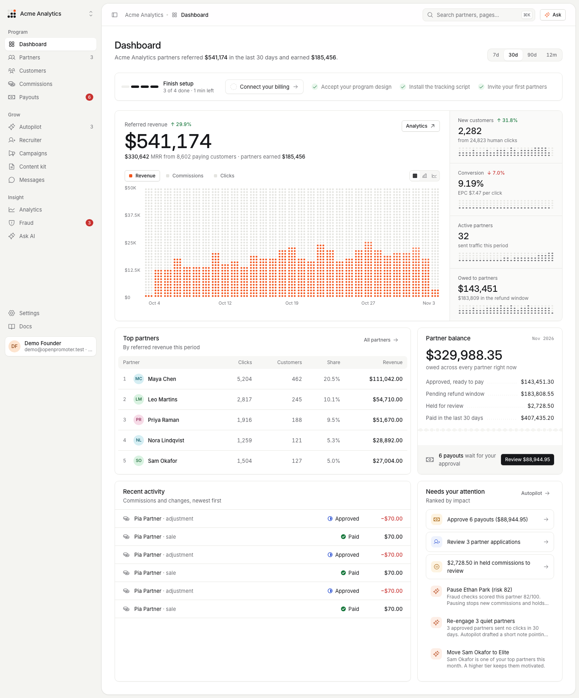
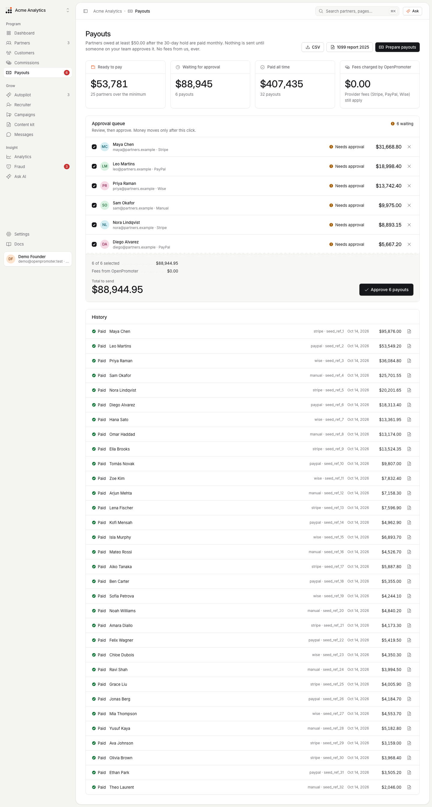
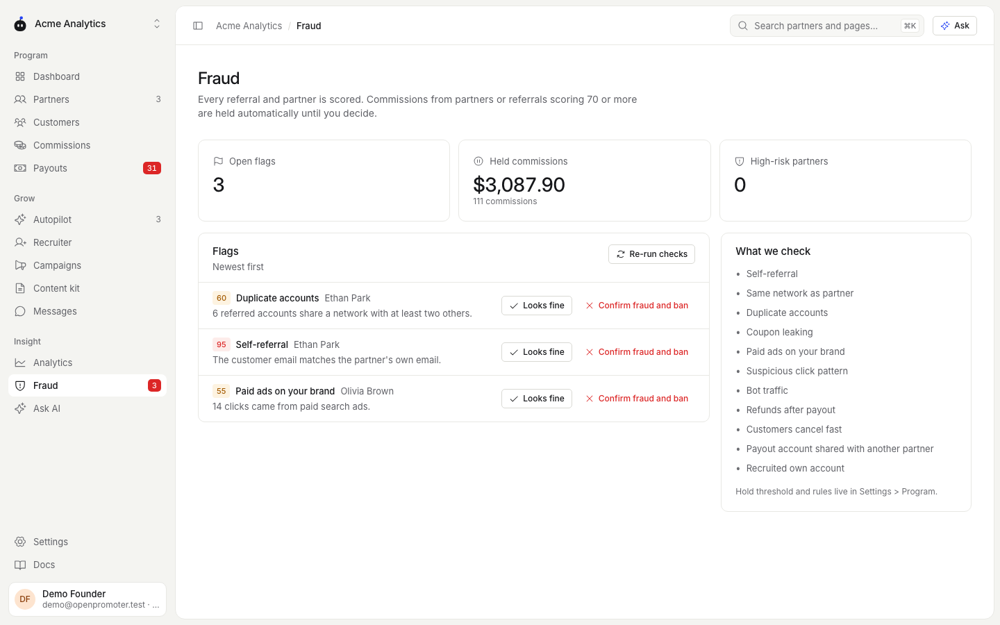
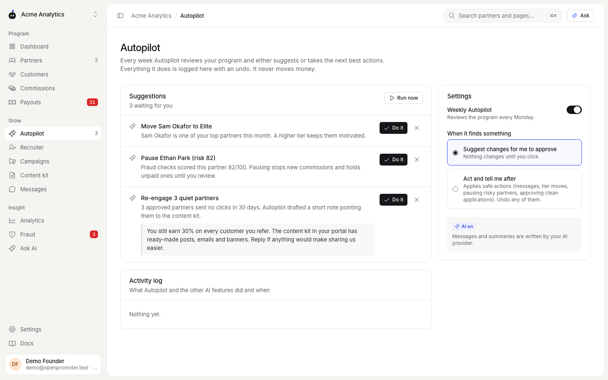
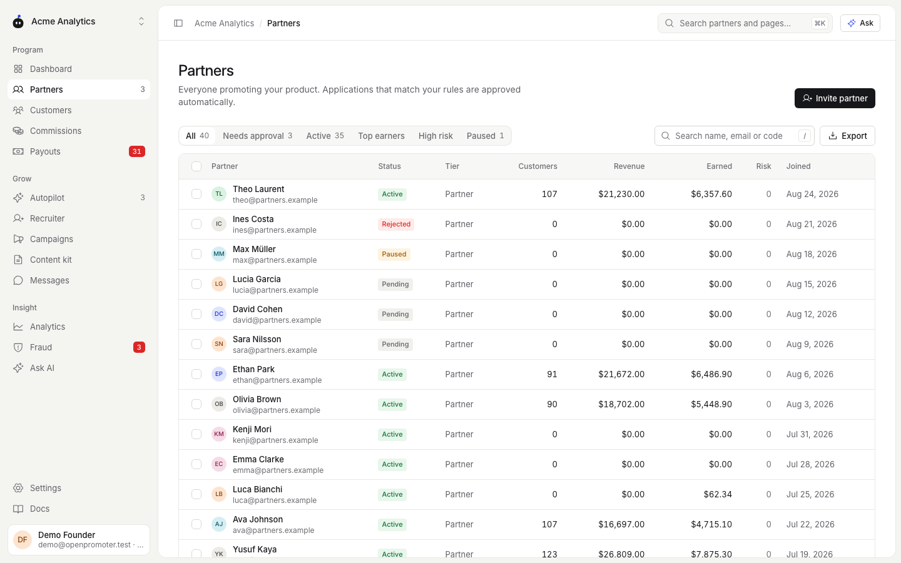

<div align="center">

<a href="https://openpromoter.com">
  <picture>
    <source media="(prefers-color-scheme: dark)" srcset="docs/brand/logo-dark.svg">
    
  </picture>
</a>

# OpenPromoter

### Open-source affiliate and referral program software for SaaS

A self-hosted alternative to Rewardful, FirstPromoter and Tolt. Track referrals from Stripe, stop affiliate fraud and pay partners with 0% payout fees.

[Website](https://openpromoter.com) · [Live demo](https://openpromoter.com/demo/) · [Docs](https://openpromoter.com/docs/) · [Self-hosting](https://openpromoter.com/docs/self-hosting/) · [API](https://openpromoter.com/docs/api/) · [Discussions](https://github.com/openpromoter/openpromoter/discussions)

[](LICENSE)
[](#quick-start)
[](#pricing)
[](packages/mcp)

<picture>
  <source media="(prefers-color-scheme: dark)" srcset="docs/screenshots/app-dashboard-desktop-dark.png">
  
</picture>

</div>

## Why OpenPromoter

Affiliate software for SaaS usually costs $49 to $99 a month, and some tools also take a share of every payout. OpenPromoter is open source and free to self-host. Every feature ships in this repository.

- **0% of your payouts** on every plan, self-hosted or Cloud.
- **Every billing system at once:** Stripe, Paddle, Lemon Squeezy, Polar and Chargebee.
- **Fraud checks before money moves:** risky commissions are held for review.
- **AI with an undo button:** it designs the program and drafts the work. A person approves every payout.
- **Your data on your server:** one `docker compose up` and Postgres.

| | Entry price | Fee on payouts | Open source |
|---|---|---|---|
| **OpenPromoter** | $0 (self-host or Cloud Free) | 0% | Yes (AGPL-3.0) |
| Rewardful | $49/mo | 0%, or 3% with Managed Payouts | No |
| FirstPromoter | $49/mo | None listed | No |
| Tolt | $99/mo | 2% of payouts | No |
| Dub Partners | $81/mo | 5%, or 8% card-funded | Partner code is closed |

<sub>List prices from each vendor's pricing page as of November 2026. Sources and full comparisons: [Rewardful](https://openpromoter.com/vs/rewardful/), [FirstPromoter](https://openpromoter.com/vs/firstpromoter/), [Tolt](https://openpromoter.com/vs/tolt/) and [Dub Partners](https://openpromoter.com/vs/dub-partners/).</sub>

## Try the live demo

Open the [live demo](https://openpromoter.com/demo/) to use a working account with sample data. It has the founder dashboard and the partner portal with no sign-up and no card. It rebuilds every day and is read-only.

## Quick start

```bash
git clone https://github.com/openpromoter/openpromoter
cd openpromoter
docker compose up
```

Open http://localhost:3000 and sign in to the demo workspace with `demo@openpromoter.test` and `openpromoter-demo`. It holds 100,000 clicks, 10,000 conversions and payouts waiting for approval. Emails land in Mailpit at http://localhost:8025.

### Deploy to a server

<a href="https://render.com/deploy?repo=https://github.com/openpromoter/openpromoter"></a>

Render reads [render.yaml](render.yaml) and creates the app and its Postgres database. On Railway, Fly.io or your own VPS, run the [Dockerfile](Dockerfile) with Postgres 16 and set these variables:

| Variable | What it is |
|---|---|
| `DATABASE_URL` | Postgres connection string |
| `APP_URL` | The public URL such as `https://affiliates.yourapp.com` |
| `BETTER_AUTH_SECRET` | A long random string for sessions |
| `ENCRYPTION_KEY` | A long random string that encrypts provider keys and tax IDs |
| `SMTP_URL` or `RESEND_API_KEY` | Where email goes, with `EMAIL_FROM` as the sender |
| `SEED_DEMO` | `false` in production |

The container refuses to start on a public URL with the placeholder secrets. Every setting is in [.env.example](.env.example), and the [self-hosting guide](https://openpromoter.com/docs/self-hosting/) walks through Railway, Render and upgrades.

## How it works

1. **Paste your website.** OpenPromoter pulls your logo, color and copy to brand the partner portal.
2. **Connect Stripe** with a restricted key, or OAuth on Cloud. It imports products, customers and subscriptions and registers the webhook.
3. **Accept the AI-designed program.** Rate, duration, cookie window, customer discount, tiers and payout rules each come with a short reason.
4. **Install the tracking script.** Add one script tag, use the npm SDK or paste one prompt into any coding agent.
5. **Invite partners.** The recruiter has already ranked your happiest paying customers.

## Features

### Affiliate tracking with Stripe attribution

- First-party cookie through `op.js` with a configurable window and first-click or last-click attribution.
- Consent mode, cookieless mode and a first-party route that ad blockers leave alone.
- Server-side attribution through Stripe Checkout `client_reference_id`, customer metadata and promotion codes.
- Coupon attribution without a click and signup (lead) tracking.
- A discount for referred customers, applied at Stripe Checkout by the SDK.
- Short links, deep links, sub-IDs, UTM capture, QR codes and custom domains such as `partners.yourapp.com`.
- Trials, upgrades, refunds, chargebacks and cancellations adjust commissions automatically.

### Fraud detection

Every referral gets a risk score from 0 to 100. It checks self-referral, shared networks, duplicate accounts, coupon leaks and paid ads on your brand. It also catches click spam, bots, refunds after payout, fast churn, shared payout accounts and self-recruiting. Commissions above your threshold are held until you review them.

### Partner and affiliate management

- A branded partner portal on your own domain or embedded in your app.
- Applications with custom questions and auto-approve rules. Approved and rejected applicants each get an email.
- Tiers with automatic promotion and per-partner rates.
- Public, private or invite-only programs.
- Messages, announcements, campaigns, bounties and contests.
- Two-tier commissions, one level deep and off by default.
- A public partner marketplace that founders opt into.
- CSV import from Rewardful, FirstPromoter, Tolt or PartnerStack. Old `?via=`, `?fpr=`, `?ref=` and `?gspk=` links keep working.

### Payouts and tax

- A ledger that moves each commission from pending to approved to paid, or to held and reversed.
- Refund hold periods, minimum payouts and multiple currencies.
- Pay through Stripe Connect Express, PayPal Payouts, Wise or a CSV export.
- Every batch waits for a person to approve it. Large batches ask for a fresh 2FA code.
- W-9 and W-8BEN collection, a 1099-NEC export and self-billed invoices with EU reverse charge and VIES checks.

### AI that you can undo

AI features run on Anthropic by default. OpenAI and any OpenAI-compatible endpoint such as Ollama or LM Studio also work. Without a key, rules and templates stand in for the model.

- **Program designer** proposes commission, duration and tiers from your prices.
- **Recruiter** ranks customers and creators and drafts their invites.
- **Weekly Autopilot** re-engages quiet partners, promotes top performers and pauses risky ones. Every action is logged with an undo.
- **Campaign builder** turns one sentence into a ready boost or contest.
- **Content kit** writes swipe copy, posts and emails for partners.
- **Assistant** answers questions about your program in plain English.

AI never moves money. API keys, the MCP server and AI can prepare payouts, and only a signed-in person can approve them.

### Analytics

- Referred revenue, MRR, clicks, signups, conversion, EPC and LTV for each partner.
- Funnel, cohorts, top sources and links, owed against paid and period comparison.
- Visitor analytics for every partner: clicks per day, sources, countries, devices, landing pages and sub-IDs. Partners see their own on a Traffic page.
- CSV exports and weekly or monthly email reports.

### Team and security

- Workspaces with several programs and owner, admin, finance and viewer roles.
- An audit log of every money, permission and AI action.
- TOTP two-factor sign-in, encrypted provider keys and hashed IP addresses. Details: [SECURITY.md](SECURITY.md).

<p align="center">




</p>

## Integrations

| Billing | Payouts | Tracking | Alerts |
|---|---|---|---|
| Stripe | Stripe Connect Express | Script tag (`op.js`) | Slack |
| Paddle | PayPal Payouts | TypeScript SDK | Discord |
| Lemon Squeezy | Wise | REST API | Signed webhooks |
| Polar | CSV export | Stripe metadata | Email reports |
| Chargebee | | Coupon codes | |

Any other billing system can report payments through `POST /api/v1/conversions`.

## For developers and AI agents

- **REST API** with an [OpenAPI spec](https://openpromoter.com/docs/api/) at `/api/openapi.json` and scoped API keys.
- **Webhooks** signed with HMAC-SHA256, with retries and a delivery log.
- **TypeScript SDK:** `npm install openpromoter`. See [packages/sdk](packages/sdk).
- **CLI:** `npx openpromoter-cli`. Its `listen` command forwards events to localhost. See [packages/cli](packages/cli).
- **MCP server** for any MCP client: Claude Desktop, Claude Code, Codex, Cursor, VS Code with GitHub Copilot, Windsurf, Gemini CLI and Zed. It is read-only by default and no tool can send money. See [packages/mcp](packages/mcp).
- **Agent skill:** `npx -y openpromoter-cli skill` installs an "add an affiliate program" skill for Claude Code, Codex and Cursor. Any other coding agent works with the [one-prompt install](https://openpromoter.com/docs/agent-skill/).

```json
{
  "mcpServers": {
    "openpromoter": {
      "command": "npx",
      "args": ["-y", "openpromoter-mcp"],
      "env": { "OPENPROMOTER_API_KEY": "op_sk_...", "OPENPROMOTER_URL": "http://localhost:3000" }
    }
  }
}
```

## Pricing

**Self-host:** free, with every feature and no limits on partners or revenue.

**[OpenPromoter Cloud](https://openpromoter.com/pricing/):** free up to $1,000 a month in partner revenue. Above that, plans cost $29, $79 or $199 a month with AI included. No plan takes a percentage of your payouts.

## Tech stack

Next.js, React, TypeScript, PostgreSQL with Drizzle ORM, Better Auth, Tailwind CSS and Docker. Architecture notes are in [ARCHITECTURE.md](ARCHITECTURE.md).

## Development

```bash
pnpm install
docker compose up -d postgres mailpit
cp .env.example apps/app/.env.local
pnpm db:migrate && pnpm db:seed
pnpm --filter @openpromoter/app dev   # http://localhost:3000
pnpm test && pnpm e2e && pnpm lint
```

## Contributing

Bug reports, ideas and pull requests are welcome. Read [CONTRIBUTING.md](CONTRIBUTING.md) first and sign the [contributor agreement](CLA.md) in your pull request. Ask questions in [GitHub Discussions](https://github.com/openpromoter/openpromoter/discussions). Report security issues privately as [SECURITY.md](SECURITY.md) explains.

If OpenPromoter helps you, a star on GitHub helps other founders find it.

## License

The app and server are [AGPL-3.0](LICENSE). Anyone can use and self-host them for free. If you run a modified version as a service for others, you must publish your changes under AGPL-3.0.

The pieces you install in your own code or website are [MIT](packages/sdk/LICENSE). They are the SDK, the CLI, the MCP server and the scripts served to your site (`op.js` and `embed.js`).

## Who builds it

OpenPromoter is built by [Yash Kapoor](https://openpromoter.com/blog/author/yash-kapoor/), founder of [DevDiggers](https://devdiggers.com). DevDiggers also makes a [WooCommerce affiliate plugin](https://devdiggers.com/product/woocommerce-affiliates/) that online stores use to run their own affiliate programs. OpenPromoter brings that experience to SaaS as open source.

Follow along on [X](https://x.com/IamYashKapoor), [GitHub](https://github.com/IamYashKapoor) or [LinkedIn](https://www.linkedin.com/in/iamyashkapoor/).
