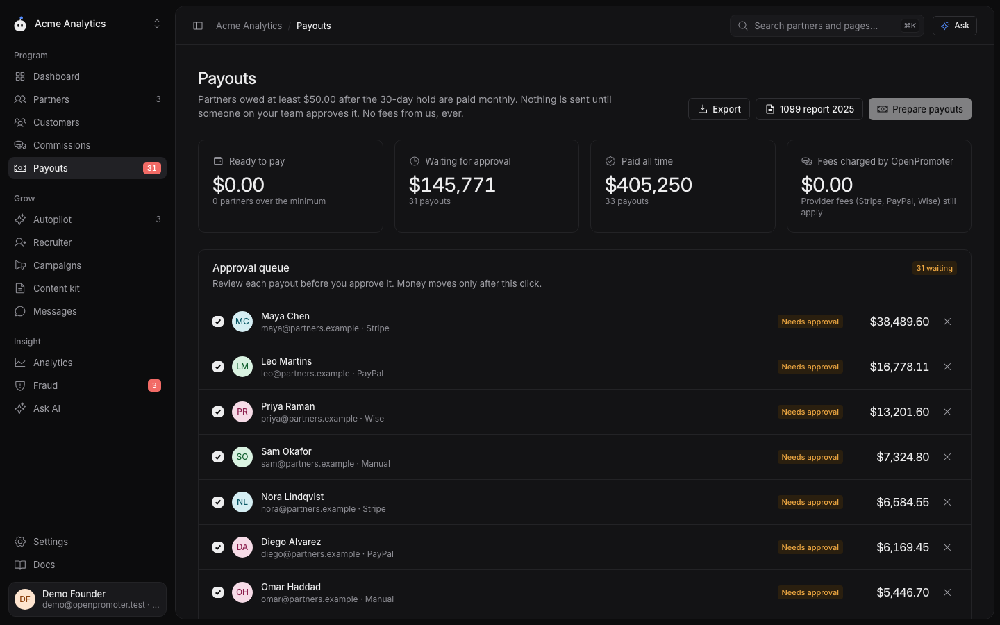

<div align="center">

# OpenPromoter

**The open-source alternative to Rewardful and FirstPromoter.**
The affiliate and referral program for SaaS that runs itself. Connect Stripe and OpenPromoter designs the program, recruits partners, stops fraud, writes their marketing and prepares their payouts.

[](LICENSE)
[](#quick-start)
[](#pricing)
[](packages/mcp)

[Website](https://openpromoter.com) · [Docs](https://openpromoter.com/docs) · [Self-hosting](https://openpromoter.com/docs/self-hosting) · [API](https://openpromoter.com/docs/api)


</div>

## Why

SaaS teams pay $49–$199 a month for Rewardful, FirstPromoter or Tolt, and Dub Partners adds a percentage of every payout. The open-source options are early or limited.

OpenPromoter is fully open source (every feature, AGPL-3.0, no "enterprise" folder) and sets up in about five minutes. It takes **0% of your payouts** on every self-hosted and cloud plan.

## Quick start

```bash
git clone https://github.com/openpromoter/openpromoter
cd openpromoter
docker compose up
```

Open http://localhost:3000 and sign in with the demo workspace: `demo@openpromoter.test` / `openpromoter-demo` (100k clicks, 10k customers, payouts waiting for approval). Emails land in Mailpit at http://localhost:8025. Or create your own account and follow the five-step setup.

[](https://render.com/deploy?repo=https://github.com/openpromoter/openpromoter) [](https://railway.com/new/template?template=https://github.com/openpromoter/openpromoter) (Railway: add a Postgres service and set `DATABASE_URL`, `APP_URL`, `BETTER_AUTH_SECRET` and `ENCRYPTION_KEY`.)

Before exposing it on a real domain, set `APP_URL`, `BETTER_AUTH_SECRET`, `ENCRYPTION_KEY` and `SEED_DEMO=false`. The container refuses to start on a public URL with the placeholder secrets. All settings: [.env.example](.env.example).

## Five-minute setup

1. **Paste your website.** Logo, color and copy are pulled in to brand the partner portal and write the content kit.
2. **Connect Stripe** with a restricted key (or OAuth on Cloud). Products, prices, customers and subscriptions are imported and the webhook is registered for you.
3. **Accept the AI-designed program**: rate, duration, cookie window, customer discount, tiers and payout rules. Each comes with a one-paragraph explanation.
4. **Install**: one script tag, the npm SDK or a prompt you paste into Claude Code or Cursor.
5. **Invite partners**: the recruiter has already ranked your happiest paying customers.

The end-to-end test (`pnpm e2e`) runs this whole flow in about 15 seconds. It goes from signup to a paid partner and a refund clawback.

## Features

**Tracking and attribution**
- First-party cookie via `op.js` with a configurable window and first- or last-click attribution.
- Consent mode (`data-consent="required"`), cookieless mode (`data-storage="none"`) and an ad-blocker-proof first-party route (`data-api`).
- Server-side attribution through Stripe: Checkout `client_reference_id`, customer or subscription metadata and promotion codes. Coupon attribution without a click and signup (lead) tracking.
- Short links, deep links, sub-IDs, UTM capture, QR codes and custom domains (`partners.yourapp.com`).
- Trials, upgrades, downgrades, refunds (pro-rata, before or after payout), chargebacks and cancellations adjust commissions automatically.
- Stripe, Paddle, Lemon Squeezy, Polar and Chargebee through one billing adapter; any other billing system through `POST /api/v1/conversions`.

**AI that does the work with an undo button** (a reduced rules-and-templates form works without an AI key; AI never moves money)
- Program designer and partner recruiter (customers and creators via web search).
- Weekly **Autopilot**: it re-engages idle partners, promotes top partners, pauses risky ones, proposes boosts, approves clean applications and prepares payouts.
- One-sentence **campaign builder** for bounties, contests and boosts.
- **Content kit** with banners and a plain-English **assistant** over your data.
- Fraud scoring checks for self-referral, shared networks, duplicate accounts and coupon leaks. It also catches paid-search brand bidding, click spam, bots, refunds after payout, fast churn, shared payout accounts and self-recruiting in two-tier programs. Commissions above a risk score you choose are held.

**Partners**
- Applications with custom questions and auto-approve rules.
- Tiers with automatic promotion and per-partner rates.
- Public, private or invite-only programs.
- Messages, announcements and resources.
- Two-tier commissions: partners recruit sub-partners with their own recruit link and earn an override on their commissions. Off by default and one level deep.
- A public partner marketplace. Partners filter listed programs by category and commission type and apply in one click. Founders opt in from Settings.
- Multi-program partner accounts and an embeddable in-app dashboard.
- CSV import from Rewardful, FirstPromoter, Tolt or PartnerStack. Old `?via=`, `?fpr=`, `?ref=` and `?gspk=` links keep working.

**Money**
- Ledger with pending → approved → held → paid → reversed states.
- Refund hold period, minimum payout and multi-currency.
- Scheduled batches always wait for a human. Large batches need a 2FA re-check.
- Stripe Connect Express, PayPal Payouts, Wise or manual with CSV.
- W-9 and W-8BEN, 1099-NEC export ($600 for pre-2026 payments, $2,000 for 2026), self-billed invoices with EU reverse charge and VIES VAT checks.

**Analytics**
- Referred revenue, MRR, clicks, signups, conversion, EPC and LTV per partner.
- Funnel, cohorts, top sources and links, owed vs paid and period comparison.
- CSV exports, weekly or monthly email reports and live refresh.

**Developers and agents**
- REST API with [OpenAPI](apps/app/src/server/api.ts) (`/api/openapi.json`) and scoped API keys.
- Signed webhooks with retries and a delivery log. Slack and Discord alerts.
- TypeScript SDK (`openpromoter`) and CLI (`openpromoter-cli`, including `listen` to forward events to localhost).
- MCP server (`openpromoter-mcp`). It is read-only by default and no tool can send money.
- An agent skill for Claude Code and Cursor.

**Team**
- Workspaces with several programs, roles (owner, admin, finance and viewer), an audit log and 2FA.
- Light and dark mode, a command palette (⌘K) and keyboard shortcuts.

<p>


</p>

## Pricing

Self-host: free with every feature and no limits. Cloud: free up to $1k/month partner revenue and $29, $79 or $199 flat per month above that, with AI included. **No percentage of payouts on any plan.**

## Agents

```json
{ "mcpServers": { "openpromoter": { "command": "npx", "args": ["-y", "openpromoter-mcp"], "env": { "OPENPROMOTER_API_KEY": "op_sk_...", "OPENPROMOTER_URL": "http://localhost:3000" } } } }
```

`npx openpromoter-cli skill` installs the "add an affiliate program" skill into `.claude/skills` and `.cursor/rules`.

## Development

```bash
pnpm install
docker compose up -d postgres mailpit
cp .env.example apps/app/.env.local
pnpm db:migrate && pnpm db:seed
pnpm --filter @openpromoter/app dev        # http://localhost:3000
pnpm test && pnpm e2e && pnpm lint
```

Architecture: [ARCHITECTURE.md](ARCHITECTURE.md).

## Known gaps

- Stripe payouts use Connect Express (v1) accounts; Accounts v2 is planned.
- No Stripe payment-method fingerprint matching in fraud checks yet.
- PayPal unclaimed payouts are not re-queued automatically.
- Page copy is English only; the i18n catalog covers the app shell.

## License

The app and server are [AGPL-3.0](LICENSE). Anyone can use and self-host them for free. If you run a
modified version as a service for others, you must publish your changes under AGPL-3.0.

The pieces you install in your own code or website are [MIT](packages/sdk/LICENSE). They are safe for
any codebase: the SDK (`packages/sdk`), the CLI (`packages/cli`), the MCP server (`packages/mcp`)
and the scripts served to your site (`op.js` and `embed.js`).

Contributions are welcome under the [contributor agreement](CLA.md). See [CONTRIBUTING.md](CONTRIBUTING.md).

Built by [DevDiggers](https://devdiggers.com). Not affiliated with Rewardful, FirstPromoter, Tolt, Dub or Stripe.
